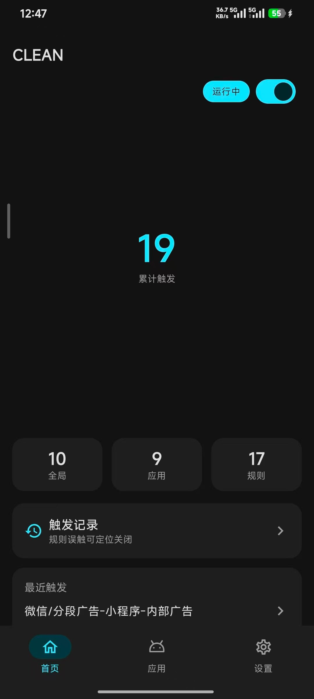
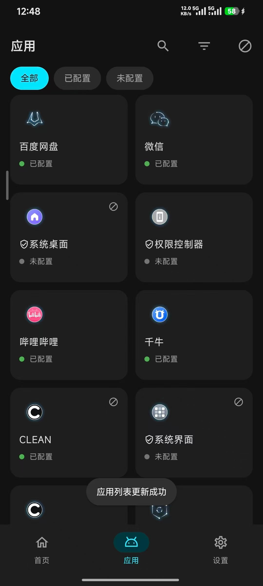
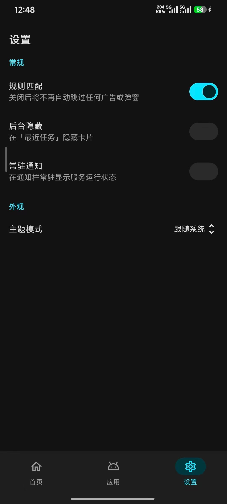
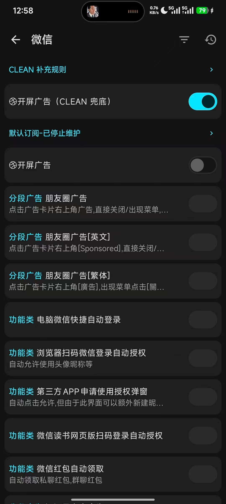

# CLEAN

自动跳过**开屏广告**与**弹窗广告**的 Android 应用。

装上、授权，然后用你的手机就行 —— **不需要配置任何规则**。

## 下载

| 文件 | 说明 |
| --- | --- |
| [`dist/CLEAN-free-1.0.0.apk`](dist/) | **free 版**：激活门禁关闭，装完即可用，无需激活码 |

同一份代码出两种包：

```bash
# free 版（激活门禁关闭）
./gradlew :clean-app:assembleRelease -PCLEAN_FREE=true

# 需要激活码的版本
./gradlew :clean-app:assembleRelease
```

- 两个包共用包名 `com.clean.click`。**签名不同就无法互相覆盖安装**，切换前需先卸载，会丢本地设置。

## 截图

 

 

> 这里刻意用 HTML 的 img 标签，而不是 Markdown 的图片语法：某些 Markdown 格式化工具会把
> 方括号转义，那样 GitHub 会把图片当作纯文本、截图就不再显示。

## 功能

- **自动跳过开屏广告**：App 启动时自动点掉「跳过」
- **自动关闭弹窗广告**：弹窗出现时自动点掉关闭按钮
- **首页数据仪表盘**：累计触发次数，以及「全局 / 应用 / 规则」三项统计；一眼看到最近一次触发发生在哪个应用的哪条规则
- **应用列表**：双列网格，绿点表示「已配置」、灰点表示「未配置」，可按状态筛选
- **触发记录**：每次自动点击的记录；顶部还会显示「最近未触发的规则」，直接告诉你某条规则卡在了什么状态（如「超出匹配时间」）
- **节点审查**：查看当前屏幕的无障碍节点树，用于定位「规则为什么没匹配上」
- **设置**：规则匹配总开关、后台隐藏、常驻通知、主题模式
- **无障碍守护**：系统（如 ColorOS）在长时间后台后会关闭无障碍服务，应用会尽快发现并提醒你一键恢复；
  设置页的「无障碍守护」可查看状态与累计被关闭次数，详见 [docs/10](docs/10-无障碍存活守护.md)

## 使用

1. 安装后，按引导开启**无障碍服务**（这是拦截广告所必需的权限）
2. 无需其它配置：启动时会自动拉取规则订阅；拉不到（无网 / CDN 不可用）时用随包规则兜底
3. `dist/` 里的 **free 版装完即可用，不需要激活码**；需要激活码的版本另行分发

如果发现某个广告没被跳过，请依次看：

- 首页「触发记录」→ 顶部「最近未触发的规则」，看规则卡在了什么状态
- 触发记录页右上角的「节点审查」，看该界面到底有哪些节点

## 关于规则来源（如实说明）

规则有**三条来源**，启动后的优先级是：

1. **联网订阅（优先）**：第三方公开订阅 `@fkybnjd/gkd-subscription-cn`（AIsouler 的国内版规则），
   从 npm 镜像 / CDN 拉取并带多个备用地址；联网正常时以它为准，且支持「检查更新」持续更新。
2. **随包兜底**：`assets/gkd-fallback.json5`，是上游 `@gkd-kit/subscription` 的一份快照
   （该订阅正文自称「默认订阅-已停止维护」）。所有网络地址都失败时改用它，保证离线也有规则可用。
3. **CLEAN 自有补充规则**：`assets/clean-rules.json5`。上游把开屏广告的通用兜底对约 107 个应用
   显式关闭了（前提是这些应用各有专属规则），CLEAN 为这些应用补了一条更严格的兜底
   （要求节点可点击、文案长度受限），**默认关闭**，可在「应用」页里手动打开。

> 规则内容是第三方公开数据，本项目不改写在线订阅的内容；随包那份只做本地修正与兜底。
> 在线那份订阅自身的默认策略是「只启用开屏广告」，其余类别需用户手动打开。

## 隐私

- 无需注册或登录
- **不收集、不上传**任何屏幕内容、应用列表或使用数据
- 无障碍节点数据仅在本机内存中用于规则匹配，不写入文件、不发送到任何服务器
- 联网只有两处：拉取规则订阅；应用内的帮助 / 条款页（WebView，从公开 CDN 取内容）

## 无障碍服务会被系统关闭

ColorOS 等系统会在长时间后台运行后关闭侧载应用的无障碍服务。没有 ADB / Shizuku / root 时，
应用**无法自动重新打开那个开关**——它受系统的「写入安全设置」权限保护，只有系统签名、预置应用或特权身份能写。
CLEAN 能做的是把"失联"这件事变得短而可见：

- **尽快发现**：无障碍服务销毁（秒级）／前台服务轮询／JobScheduler 周期任务（进程被杀后仍能自检）／闹钟 + 开机广播；
- **一键恢复**：发高优先级通知，点击直达本应用的无障碍开关页，返回后自动复核；
- **可核对**：设置页「无障碍守护」显示运行状态、累计被系统关闭次数与上次时间。

完整方案、预期效果与局限见 [docs/10-无障碍存活守护.md](docs/10-无障碍存活守护.md)。

## 开源与致谢

本项目基于 [GKD](https://github.com/gkd-kit/gkd) 二次开发，遵循 **GPL-3.0-only** 许可（见 [LICENSE](/LICENSE)）。

感谢上游作者与社区：

- [gkd-kit/gkd](https://github.com/gkd-kit/gkd) —— 本项目的上游
- [gkd-kit/subscription](https://github.com/gkd-kit/subscription) —— 规则订阅
- [gkd-kit/inspect](https://github.com/gkd-kit/inspect) —— 节点审查工具的思路来源
- [lisonge/kotlin-json5](https://github.com/lisonge/kotlin-json5)、[priv-kit/priv-kit](https://github.com/priv-kit/priv-kit) 等衍生库

## 免责声明

本项目仅供学习交流。请遵守当地法律法规与各应用的服务条款，不得用于任何非法用途。

---

<details>
<summary>开发者：项目结构（点击展开）</summary>

| 目录 | 说明 |
| --- | --- |
| `clean-app/` | Android 主应用（`applicationId = com.clean.click`） |
| `clean-selector/` | 选择器解析与匹配引擎 |
| `clean-db/` | Room 数据库 |
| `clean-hidden-api/` | 隐藏 API 访问 |
| `clean-app/src/main/assets/gkd-fallback.json5` | 随包兜底规则（上游订阅快照） |
| `clean-app/src/main/assets/clean-rules.json5` | CLEAN 自有补充规则（本地订阅内容） |

构建：

```bash
# debug
./gradlew :clean-app:assembleDebug

# release（需要外部提供签名，不会回退到 debug 签名）
GKD_STORE_FILE=/path/to/keystore.jks \
GKD_STORE_PASSWORD=... \
GKD_KEY_ALIAS=... \
GKD_KEY_PASSWORD=... \
./gradlew :clean-app:assembleRelease
```

测试：

```bash
./gradlew :clean-app:testDebugUnitTest :clean-selector:jvmTest
```

</details>
